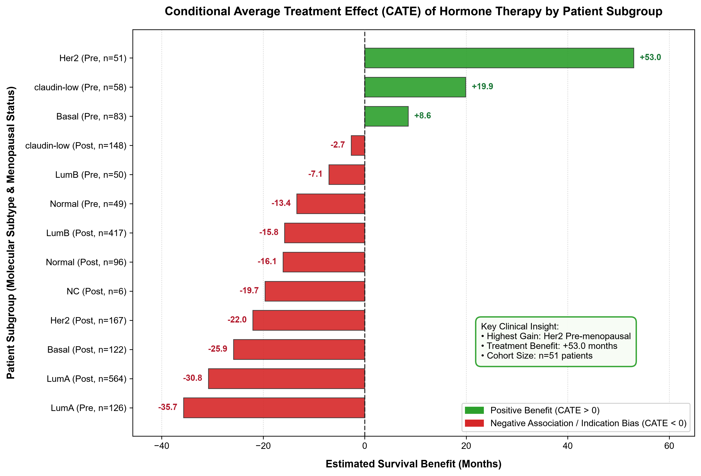
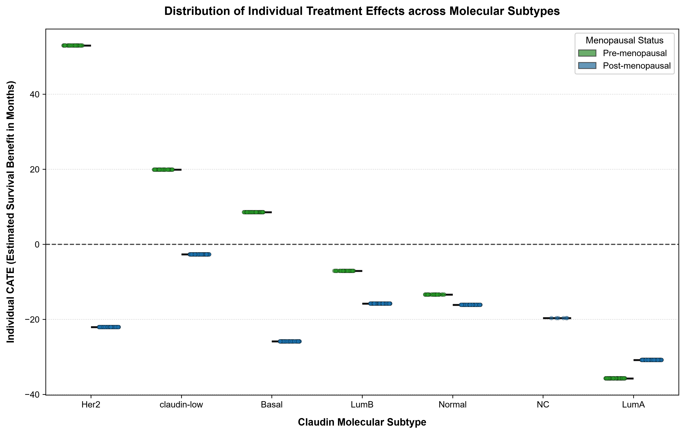

# 🧬 Causal AI in Precision Oncology: Estimating Hormone Therapy Benefit in Breast Cancer


An end-to-end Machine Learning pipeline moving beyond traditional correlational prediction to **Causal Inference**. This project leverages **Double Machine Learning (CausalForestDML)** to estimate the personalized Conditional Average Treatment Effect (CATE) of Hormone Therapy in Breast Invasive Carcinoma, effectively overcoming the pervasive clinical challenge of *Confounding by Indication*.

## 🔬 Project Overview & Clinical Goal

In observational clinical datasets, standard Machine Learning models often learn harmful biases. For instance, a naive model might conclude that Hormone Therapy *reduces* patient survival (Initial ATE: -22.48 months). This is a classic example of **Confounding by Indication**: doctors prescribe systemic therapies to patients with more aggressive or advanced disease, creating a spurious negative correlation between treatment and survival.

**The Goal:** To isolate the true, causal impact of Hormone Therapy on Overall Survival (OS) by controlling for disease severity, and to identify specific molecular and clinical subgroups that derive the maximum survival benefit (Precision Medicine).

## 📐 Causal Methodology

This pipeline was applied to the **METABRIC** cohort. After rigorous missing-value imputation and clinical harmonization, the analytical cohort consisted of **N = 1,937** patients.

We formalized the causal graph and estimated effects using `EconML`'s **CausalForestDML** (employing `RandomForestRegressor` and `RandomForestClassifier` as nuisance models):

* **Treatment / Intervention (T):** Hormone Therapy (Binary: Yes/No)
* **Outcome (Y):** Overall Survival in Months (Continuous)
* **Confounders (W):** Age at Diagnosis, Tumor Stage (derived from the Nottingham Prognostic Index), and ER IHC Status. *(Controlled to eliminate indication bias).*
* **Effect Modifiers (X):** Claudin Molecular Subtype, Inferred Menopausal State. *(Used to calculate personalized heterogeneity / CATE).*

## 📊 Key Clinical Findings

Moving from linear adjustments to Non-parametric Double Machine Learning revealed profound Treatment Effect Heterogeneity (Global ATE refined to -17.45 months):

> **🏆 The "Golden" Subgroup (Highest Benefit):**
> **Her2-Enriched, Pre-menopausal** patients demonstrated a massive, causal survival benefit from Hormone Therapy, with a Mean CATE of **+53.0 months**. (Followed closely by *claudin-low* Pre-menopausal patients at +19.9 months).

> **⚠ Indication Bias & Negative Associations:**
> **Luminal A, Pre-menopausal** patients exhibited a strong negative association (Mean CATE: **-35.7 months**). Rather than implying the drug is biologically harmful, this highlights extreme *confounding by indication* remaining in this high-risk subgroup, suggesting these patients either had highly aggressive unrecorded covariates or required alternative aggressive therapies.

## 📈 Visualizing Treatment Heterogeneity

### 1. Causal Waterfall Plot
This chart ranks patient subgroups by their estimated survival benefit (CATE), clearly delineating which clinical profiles respond best to the intervention.



### 2. CATE Distribution across Molecular Subtypes
Demonstrates the vast intra-subtype variance. For example, note how the treatment effect in the *Her2* subtype shifts drastically based on menopausal status.



## 📁 Repository Structure

* `1_causal_data_setup.py`: Data ingestion, causal variable mapping, and missingness audit.
* `2_causal_estimation.py`: Initial DoWhy DAG setup and linear backdoor ATE estimation.
* `3_master_causal_pipeline.py`: Master script utilizing EconML CausalForestDML and CATE derivation.
* `4_causal_visualizations.py`: Generates publication-ready 300 DPI matplotlib/seaborn plots.
* `metabric_causal_results.csv`: Final analytical dataset appended with `Individual_CATE_Months`.

## 🚀 Quick Start Guide

**1. Installation:**
```bash
git clone https://github.com/<your-username>/causal-cancer-meta-analysis.git
cd causal-cancer-meta-analysis
pip install pandas numpy scikit-learn lifelines dowhy econml matplotlib seaborn
```

**2. Execution:**
```bash
# Run the master causal pipeline (trains CausalForestDML and saves results)
python 3_master_causal_pipeline.py

# Generate publication-ready 300 DPI figures
python 4_causal_visualizations.py
```

## 🔮 Future Directions (Next Steps in Precision Medicine)

While this pipeline successfully maps broad molecular subtypes to treatment effects, the next evolution of this framework will incorporate high-resolution genomic and pharmacological data:

* **Genomic Mutation Profiling:** Integrating specific somatic mutations (e.g., *TP53, PIK3CA, BRCA1/2*) into the Effect Modifiers (X) array to see if specific gene knockouts negate or amplify hormone therapy efficacy.
* **Pharmacological Granularity:** Transitioning the Treatment (T) variable from a broad "Hormone Therapy" flag to specific drug interventions (e.g., *Tamoxifen vs. Letrozole vs. Aromatase Inhibitors*) to conduct comparative causal efficacy studies.

## 🤖 Development Workflow
This project was built using an **Agentic AI Workflow**. I acted as the Domain Expert and System Architect (designing the Causal DAGs, selecting the EconML algorithms, and interpreting the clinical results), while leveraging an AI coding agent within VS Code to accelerate script generation, pipeline execution, and data visualization.
